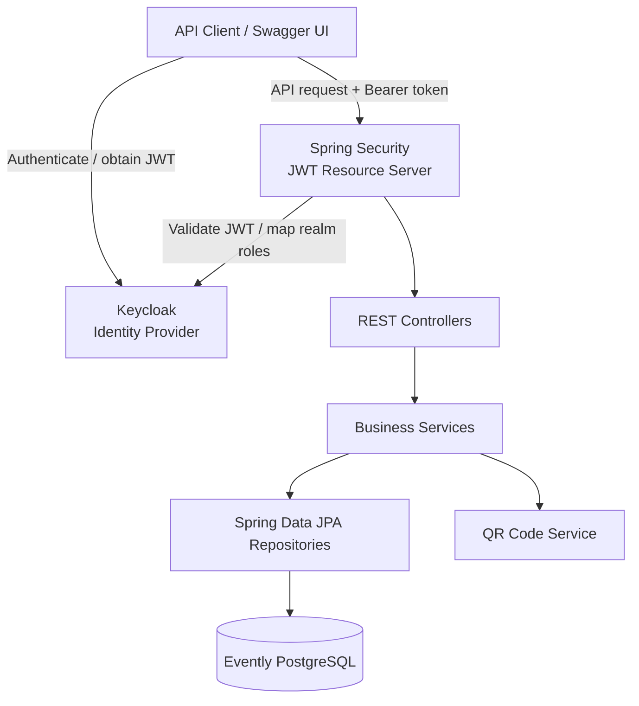

# Evently

**A Spring Boot event and ticket management backend featuring Keycloak authentication, role-based access control, QR-code ticketing, concurrency control, and transaction management.**

[](https://www.oracle.com/java/)
[](https://spring.io/projects/spring-boot)
[](https://www.postgresql.org/)
[](https://www.keycloak.org/)
[](https://maven.apache.org/)

**Repository:** [abhi07799/Evently](https://github.com/abhi07799/Evently)

---

## Contents

- [Overview](#overview)
- [Features](#features)
- [Technology Stack](#technology-stack)
- [Architecture](#architecture)
- [Authentication and Authorization](#authentication-and-authorization)
- [Concurrency and Transaction Management](#concurrency-and-transaction-management)
- [Database Design](#database-design)
- [API Reference](#api-reference)
- [Getting Started](#getting-started)
- [Configuration](#configuration)
- [API Documentation](#api-documentation)
- [Project Structure](#project-structure)
- [Known Issues and Security Notes](#known-issues-and-security-notes)
- [Future Improvements](#future-improvements)

## Overview

Evently is a RESTful backend for managing events, ticket inventory, and ticket purchases. It uses Spring Boot for application development, PostgreSQL for persistence, and Keycloak as the identity provider.

The application separates identity management from domain data:

- **Keycloak** manages user identities, credentials, and realm roles.
- **Evently's PostgreSQL database** stores user profiles and event/ticket domain data.
- **Spring Security OAuth2 Resource Server** validates Keycloak-issued JWT access tokens.
- **Spring Data JPA and Hibernate** provide persistence, including pessimistic locking for ticket inventory.

The project demonstrates backend engineering concerns including authentication, authorization, ownership checks, pagination, schema migrations, QR-code generation, concurrency control, and transaction boundaries.

## Features

### Identity and user management
- Public user registration endpoint integrated with Keycloak Admin API.
- Evently user profiles linked to Keycloak identities.
- Duplicate-email checks and database uniqueness handling.
- Compensating cleanup: if Evently profile persistence fails after Keycloak identity creation, the service attempts to delete the newly created Keycloak user.

### Event management
- Retrieve events with pagination.
- Retrieve an event by ID.
- Retrieve events associated with an organizer.
- Update event details with organizer ownership checks and an ADMIN override.

### Ticket inventory and ticketing
- Create, retrieve, update, and delete ticket-stock records.
- Purchase and cancel tickets.
- Generate and associate QR codes with purchased tickets.
- Retrieve tickets by ticket, stock, or purchaser identifiers, subject to authorization rules.

### Backend engineering
- Stateless JWT-based authentication.
- Keycloak realm-role mapping to Spring Security authorities.
- Method-level authorization using `@PreAuthorize`.
- Organizer and ticket ownership enforcement.
- Pessimistic write locking for ticket purchase operations.
- Transactional ticket purchase and cancellation.
- Flyway-managed database migrations.
- Request validation and application-specific exception handling.
- Pagination and sorting support.
- OpenAPI/Swagger UI with OAuth2 Authorization Code flow and PKCE.

## Technology Stack

| Area | Technology |
|---|---|
| Language | Java 21 |
| Framework | Spring Boot 4.1.2 |
| Build | Maven |
| Web | Spring MVC |
| Persistence | Spring Data JPA, Hibernate |
| Database | PostgreSQL |
| Schema migration | Flyway |
| Identity provider | Keycloak 24.0.1 |
| Security | Spring Security, OAuth2 Resource Server, JWT |
| API documentation | Springdoc OpenAPI |
| Object mapping | ModelMapper |
| Boilerplate reduction | Lombok |
| QR-code generation | ZXing |
| Local infrastructure | Docker Compose |

## Architecture

Evently follows a layered Spring application structure.



### Request lifecycle

1. A client authenticates with Keycloak and obtains an access token.
2. The client sends the token as a Bearer token to protected APIs.
3. Spring Security validates the JWT using the configured issuer.
4. Realm roles from the JWT's `realm_access.roles` claim are mapped to authorities such as `ROLE_ADMIN` and `ROLE_ORGANIZER`.
5. Controllers delegate operations to services.
6. Services enforce business rules and use repositories to access PostgreSQL.

## Authentication and Authorization

Evently uses Keycloak for identity management and Spring Security as an OAuth2 Resource Server.

### JWT authentication
- Configured issuer: `http://localhost:9090/realms/Evently`.
- Incoming JWT access tokens are validated by the resource server.
- The API is stateless; server-side HTTP sessions are disabled.
- CSRF protection is disabled for this stateless REST API.
- Keycloak realm roles are mapped to Spring Security authorities.

### Roles

The current role enum defines:

| Role | Responsibility / current scope |
|---|---|
| `ADMIN` | Administrative access and override permissions |
| `ORGANIZER` | Manage owned events and their ticket inventory |
| `ATTENDEE` | Purchase tickets and access permitted ticket operations |
| `STAFF` | Role is defined; a dedicated staff workflow is not currently exposed |

### Authorization highlights
- Organizers can access and update their own events; ADMIN can access events across organizers.
- Ticket-stock write operations are restricted to ADMIN and ORGANIZER, with an additional event-ownership check in the service.
- Ticket history checks prevent attendees from reading another user's ticket history.
- Ticket cancellation checks ticket ownership, with an ADMIN override.
- Administrative ticket listing and stock-specific ticket listing are ADMIN-restricted.

See [Known Issues and Security Notes](#known-issues-and-security-notes) before treating the current branch as production-ready.

## Concurrency and Transaction Management

Ticket inventory is a consistency boundary: simultaneous purchase requests must not sell more tickets than the configured stock.

### Pessimistic locking

The ticket-stock repository defines a custom query with a pessimistic write lock:

```java
@Lock(LockModeType.PESSIMISTIC_WRITE)
@Query("SELECT ts FROM TicketStockEntity ts WHERE ts.id = :id")
Optional<TicketStockEntity> findByIdWithLock(@Param("id") Long id);
```

During ticket purchase, the service:

1. Starts a database transaction.
2. Loads the requested ticket-stock row using the pessimistic write-lock query.
3. Counts tickets in `PURCHASED` status for that stock.
4. Rejects the purchase if the sold count has reached the configured capacity.
5. Creates the ticket for the currently authenticated user.
6. Generates and associates a QR code.
7. Persists the ticket and completes the transaction.

The write lock serializes competing purchase transactions targeting the same ticket-stock row. A competing transaction must wait for the lock to be released before performing its stock check, helping prevent overselling.

### Transaction boundaries

The ticket service uses `@Transactional` for ticket purchase and cancellation.

- **Purchase:** ticket creation and QR-code association are performed within the transactional service operation. A runtime failure that triggers rollback prevents a partially persisted ticket operation in the Evently database.
- **Cancellation:** the transition from `PURCHASED` to `CANCELLED` is performed within a transaction.
- **Inventory calculation:** only tickets with `PURCHASED` status are counted against stock, so cancelled tickets are excluded from the sold-ticket count.

### Cross-system registration consistency

Keycloak and Evently PostgreSQL are separate systems. A normal database transaction cannot atomically commit changes in both systems.

Registration therefore uses a compensating-action approach:

1. Create the identity in Keycloak.
2. Persist the Evently user profile.
3. If profile persistence fails, attempt to delete the newly created Keycloak identity.

This is best-effort compensation, not a distributed transaction or a full Saga implementation.

## Database Design

Flyway migrations are located under `src/main/resources/db/migration`.

The current migration set creates and evolves these domain areas:

| Domain / table area | Purpose |
|---|---|
| Users | Evently user profiles and Keycloak identity linkage |
| Events | Event details, schedule, status, and organizer association |
| Ticket stock | Ticket categories, prices, capacity, and event association |
| Tickets | Purchases, purchaser association, status, and QR-code reference |
| QR codes | Generated QR-code records |
| Ticket validation | Ticket validation records |

Keycloak uses its own database for identity-provider persistence. Evently's PostgreSQL database stores application-domain data.

Hibernate schema auto-generation is disabled (`spring.jpa.hibernate.ddl-auto=none`); Flyway manages the Evently schema.

## API Reference

The application context path is `/api/v1`. Paths below are relative to that context path.

> All endpoints other than public registration and configured API documentation routes require a valid JWT under the current `SecurityConfig`. Role and ownership restrictions are noted where implemented.

### Authentication

| Method | Endpoint | Description | Access |
|---|---|---|---|
| `POST` | `/auth/register` | Register a user and create the associated Keycloak identity | Public |

### Events

| Method | Endpoint | Description | Access |
|---|---|---|---|
| `GET` | `/events/allEvents` | Retrieve paginated events | Authenticated |
| `GET` | `/events/{eventId}` | Retrieve an event by ID | Authenticated |
| `GET` | `/events/organizer/{organizerUserId}` | Retrieve an organizer's events | ADMIN or ORGANIZER; secured service overload checks ownership |
| `PUT` | `/events/{eventId}/organizer/{organizerUserId}` | Update an event | Authenticated; service checks ownership or ADMIN |

**Implementation note:** the current `develop` branch declares the organizer GET route twice. This duplicate Spring MVC mapping should be resolved before relying on the endpoint or application startup. The current controller also does not expose an event-creation `POST` endpoint.

### Ticket stock

| Method | Endpoint | Description | Access |
|---|---|---|---|
| `POST` | `/ticket-stocks` | Create ticket stock | ADMIN or ORGANIZER; event ownership check |
| `GET` | `/ticket-stocks` | Retrieve all ticket-stock records | Authenticated |
| `GET` | `/ticket-stocks/{ticketStockId}` | Retrieve ticket stock by ID | Authenticated |
| `GET` | `/ticket-stocks/event/{eventId}` | Retrieve ticket stock for an event | Authenticated |
| `PUT` | `/ticket-stocks/{ticketStockId}` | Update ticket stock | ADMIN or ORGANIZER; event ownership check |
| `DELETE` | `/ticket-stocks/{ticketStockId}` | Delete ticket stock | ADMIN or ORGANIZER; event ownership check |

### Tickets

| Method | Endpoint | Description | Access |
|---|---|---|---|
| `GET` | `/tickets/allTickets` | Retrieve all tickets with pagination | ADMIN |
| `GET` | `/tickets/{ticketId}` | Retrieve a ticket by ID | Authenticated; owner or ADMIN |
| `GET` | `/tickets/stock/{ticketStockId}` | Retrieve tickets for a stock item | ADMIN |
| `GET` | `/tickets/purchaser/{purchaserUserId}` | Retrieve a purchaser's ticket history | ATTENDEE or ADMIN; owner or ADMIN |
| `PUT` | `/tickets/{ticketId}` | Update ticket details/status | ADMIN |
| `POST` | `/tickets/purchase` | Purchase a ticket | Authenticated; purchaser resolved from JWT |
| `PATCH` | `/tickets/{ticketId}/cancel` | Cancel a purchased ticket | Authenticated; owner or ADMIN |

Paged endpoints default to 10 records. The configured maximum page size is 100. Query parameters are `page` and `size`.

## Getting Started

### Prerequisites

- Java 21
- Docker Engine or Docker Desktop with Docker Compose
- Git
- Maven (optional; the repository includes the Maven Wrapper)

### 1. Clone the repository

```bash
git clone https://github.com/abhi07799/Evently.git
cd Evently
git checkout develop
```

### 2. Start local infrastructure

The repository includes Docker Compose configuration for PostgreSQL, Adminer, and Keycloak.

```bash
docker compose up -d
```

| Service | Local URL / port |
|---|---|
| PostgreSQL | `localhost:5432` |
| Adminer | `http://localhost:7070` |
| Keycloak | `http://localhost:9090` |

The Compose file uses development credentials and Keycloak's development startup mode. Do not reuse these defaults in production.

### 3. Configure Keycloak

Before calling protected Evently APIs, configure the realm and clients expected by the application.

The current application configuration expects:

- Realm: `Evently`
- Issuer: `http://localhost:9090/realms/Evently`
- Realm roles: `ADMIN`, `ORGANIZER`, `ATTENDEE`, `STAFF`
- A Swagger OAuth2 client configured for Authorization Code flow with PKCE.
- A confidential service client for the Keycloak Admin API.

The Swagger client's redirect URI must match:

```text
http://localhost:8080/api/v1/swagger-ui/oauth2-redirect.html
```

Client IDs and the service-client secret must match your Keycloak configuration and application settings.

### 4. Configure database credentials and secrets

The default local Evently datasource is:

```text
jdbc:postgresql://localhost:5432/evently
```

Update datasource settings if your local database differs. Supply the Keycloak service-client secret through the `KEYCLOAK_CLIENT_SECRET` environment variable.

### 5. Run the application

**macOS / Linux**
```bash
./mvnw spring-boot:run
```

**Windows**
```powershell
.\mvnw.cmd spring-boot:run
```

Or build and run the JAR:

```bash
./mvnw clean package
java -jar target/Evently-0.0.1-SNAPSHOT.jar
```

Flyway migrations are configured to manage the Evently schema on application startup.

> **Startup check:** resolve the duplicate organizer GET mapping in [Known Issues and Security Notes](#known-issues-and-security-notes) before expecting the current branch to start successfully.

## Configuration

Important settings are defined in `src/main/resources/application.properties`.

| Property | Current default / purpose |
|---|---|
| `server.port` | `8080` |
| `server.servlet.context-path` | `/api/v1` |
| `spring.datasource.url` | `jdbc:postgresql://localhost:5432/evently` |
| `spring.datasource.username` | `postgres` |
| `spring.datasource.password` | Local development default; replace outside local development |
| `spring.jpa.hibernate.ddl-auto` | `none` |
| `spring.security.oauth2.resourceserver.jwt.issuer-uri` | `http://localhost:9090/realms/Evently` |
| `keycloak.server-url` | `http://localhost:9090` |
| `keycloak.realm` | `Evently` |
| `keycloak.admin.client-secret` | `${KEYCLOAK_CLIENT_SECRET}` |

For production, externalize credentials and environment-specific URLs. Never commit real secrets to source control.

## API Documentation

Springdoc OpenAPI and Swagger UI are configured in the application.

With the application running locally:

- Swagger UI: `http://localhost:8080/api/v1/evently`
- OpenAPI JSON: `http://localhost:8080/api/v1/v3/api-docs`

Swagger UI uses OAuth2 Authorization Code flow with PKCE. Configure the matching public client and redirect URI in Keycloak, then use **Authorize** to test secured endpoints.

## Project Structure

```text
Evently/
├── docker/
│   └── postgresql/
├── src/
│   ├── main/
│   │   ├── java/com/abhishek/evently/
│   │   │   ├── aspects/
│   │   │   ├── config/
│   │   │   ├── controller/
│   │   │   ├── dto/
│   │   │   ├── entity/
│   │   │   │   └── enums/
│   │   │   ├── exception/
│   │   │   ├── repository/
│   │   │   └── service/
│   │   └── resources/
│   │       ├── db/migration/
│   │       └── application.properties
│   └── test/
├── docker-compose.yml
├── pom.xml
└── README.md
```

### Layer responsibilities

- `controller`: REST endpoints and HTTP request/response handling.
- `service`: business logic, ownership checks, and transaction boundaries.
- `repository`: Spring Data JPA persistence and custom locking queries.
- `entity`: JPA entities and domain enums.
- `dto`: request and response contracts.
- `config`: security, application beans, and OpenAPI configuration.
- `exception`: application-specific exceptions and error handling.
- `resources/db/migration`: versioned Flyway SQL migrations.

## Future Improvements

- Resolve the duplicate event mapping and expose a validated event-creation endpoint.
- Restrict public registration to non-privileged roles; provision ADMIN and STAFF through trusted administrative workflows.
- Add automated integration tests for concurrent ticket purchases and stock-capacity invariants.
- Add tests for role-based access, organizer ownership, ticket ownership, and cancellation rules.
- Add repeatable Keycloak realm/client bootstrap configuration for local development.
- Add containerized application packaging and a production deployment profile.
- Add observability with structured logs, metrics, and distributed tracing.
- Consider idempotency controls for purchase requests and operational handling for QR-code generation failures.

---

<p align="center">
  Built with Java, Spring Boot, PostgreSQL, and Keycloak.
</p>
